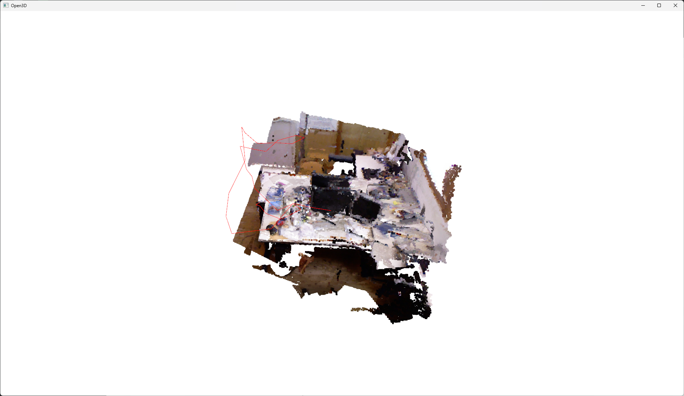
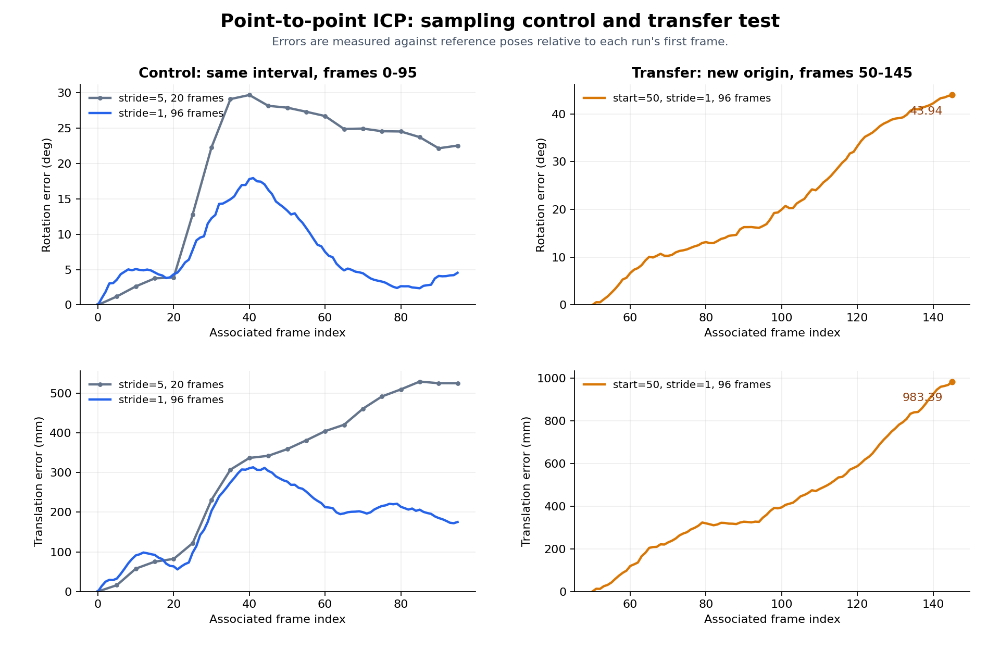
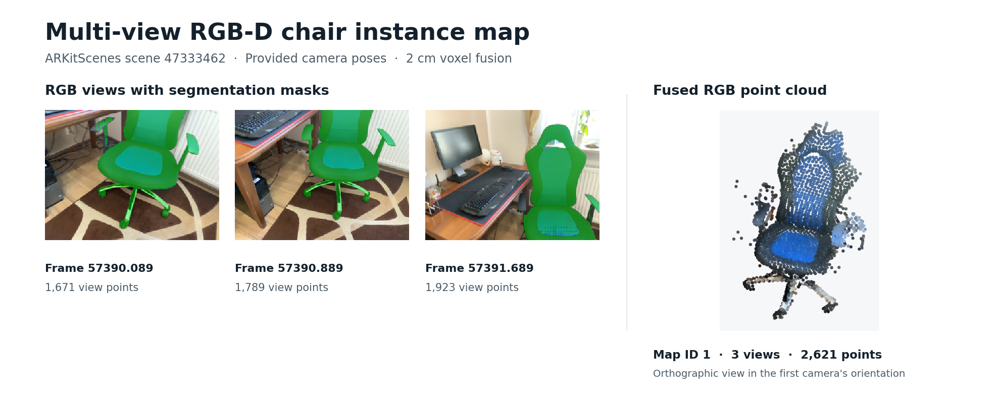
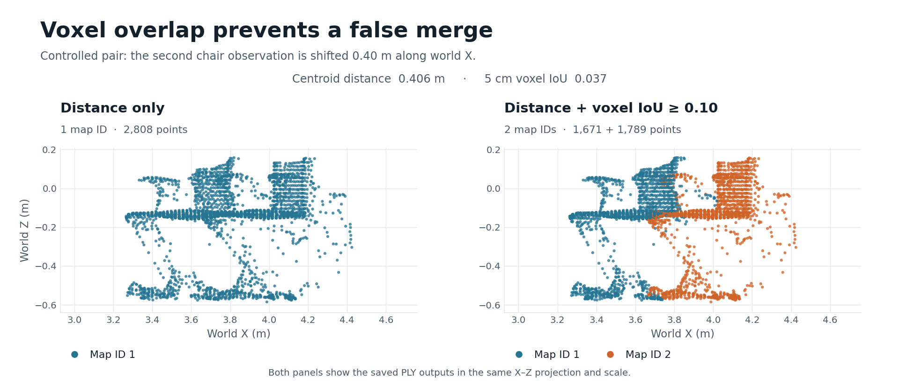
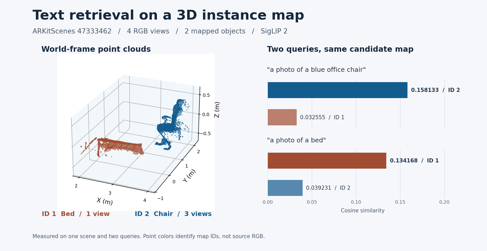
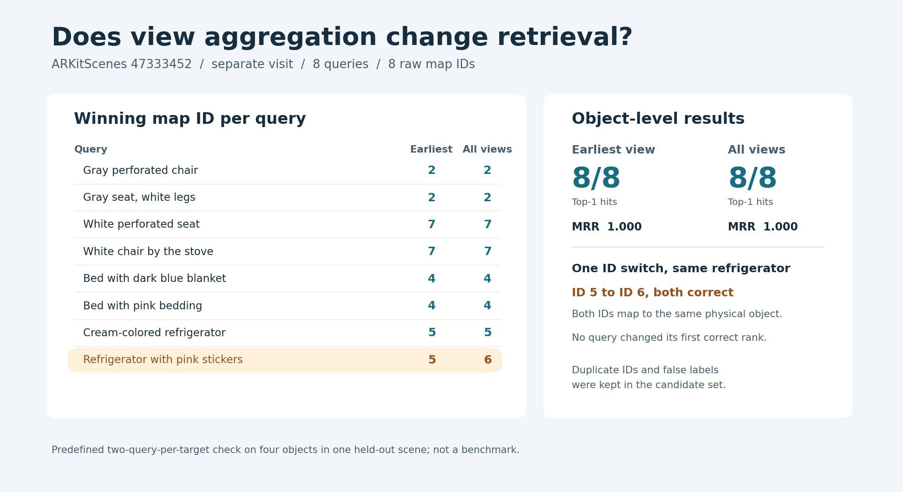

# RGB-D 多帧配准与三维实例地图

学习与工程实践项目：从 RGB-D 序列构建带稳定实例 ID 的三维物体地图，并支持简单文本检索。

当前已跑通从 RGB-D 到同一场景内两个真实物体的文本检索：用三帧椅子和一帧床构建两个地图实例，查询句从椅子换成床时，Top-1 也切换到正确的实例。[查看实测与演示](#第四关双实例文本检索运行)。第一至第三关保留了已知位姿融合、ICP 漂移分析和跨帧关联对照。

第五关把评估迁移到另一个访次的场景，固定 8 个候选和 8 条查询对照首视角与多视角，并记录重复地图 ID 和误分类。[查看留出场景对照](#第五关留出场景检索对照运行)。



图中红色折线连接所选帧的参考相机中心；地图与轨迹使用相同世界坐标系。此图展示提供位姿下的融合，不代表独立估计的轨迹。

## 目标流程

RGB-D 与相机参数 → 时间关联与反投影 → 多帧几何对齐 → 二维实例提取 → 跨帧实例关联与融合 → 三维物体地图 → 文本检索。

二维前端复用 Grounding DINO + SAM 2，实例的图文特征使用 SigLIP 2。当前 ARKitScenes 检索演示使用数据集提供的位姿建图；第二关的自写 ICP 是单独的配准与累计实验。

## 学习与实现

- [五关路线及验收](docs/ROADMAP.md)
- [第一关：已知位姿下的多帧融合](docs/STAGE_01.md)
- [第一关实测与检查记录](reports/stage01_validation.md)
- [第二关：对应点刚体拟合与 ICP](docs/STAGE_02.md)
- [对应点刚体拟合实测记录](reports/stage02_rigid_fit.md)
- [点到点 ICP 实现任务](docs/STAGE_02_ICP.md)
- [合成点云 ICP 实测记录](reports/stage02_icp_synthetic.md)
- [实现说明：真实 RGB-D 帧对配准](docs/STAGE_02_RGBD.md)
- [真实帧对实测与迭代上限诊断](reports/stage02_rgbd_pair.md)
- [短序列累计与同区间采样对照](reports/stage02_sequence.md)
- [第三关：ARKitScenes 适配与三维实例地图](docs/STAGE_03.md)
- [第三关单场景数据检查](reports/stage03_data_check.md)
- [第三关 A：新数据适配与独立区间重建](reports/stage03_arkit_preview.md)
- [第三关 B：逐帧实例导出实测与分割失败案例](reports/stage03_instance_inputs.md)
- [第三关 C：跨帧关联与体素重叠对照](docs/STAGE_03.md#c-跨帧关联与实例融合)
- [第四关：多视角特征与文本检索](docs/STAGE_04.md)
- [第四关双实例检索验收记录](reports/stage04_text_retrieval.md)
- [第五关：批量检索评估与多视角对照](docs/STAGE_05.md)
- [第五关：两场景实测与地图失败案例](reports/stage05_retrieval_comparison.md)

核心算法由学习者实现；可以调用图像读写、四元数转换、KD-tree、SVD 和点云显示等底层工具。助手协助解释、审查、调试、命令行入口整理和展示材料。

## 目录

```text
rgbd_instance_map/
├── README.md
├── requirements-geometry.txt
├── .gitignore
├── rgbd_map/              # 可复用模块
│   ├── tum_io.py
│   ├── arkit_io.py
│   ├── geometry.py
│   └── registration.py
├── scripts/               # 融合、配准、实例建图与文本检索入口
│   ├── fuse_known_poses.py
│   ├── register_rgbd_pair.py
│   ├── register_rgbd_sequence.py
│   ├── extract_instances.py
│   ├── instance_map.py
│   ├── make_retrieval_inputs.py
│   ├── export_instance_views.py
│   ├── encode_instance_views.py
│   ├── aggregate_instance_features.py
│   └── query_instance_map.py
├── experiments/           # 合成实验、场景预览和验收对照
│   ├── demo_rigid_fit.py
│   ├── demo_icp.py
│   ├── preview_arkit.py
│   ├── make_two_chairs_test.py
│   ├── make_aggregation_test.py
│   └── compare_view_features.py
├── docs/                  # 分关任务与复现说明
├── data/                 # 本地数据，不提交 Git
├── outputs/              # 完整输出，不提交 Git
├── assets/               # 精选截图和演示
└── reports/              # 实测结果和分析
```

以下命令从仓库根目录用 `python -m` 运行。正式入口写成 `python -m scripts.模块名`，实验写成 `python -m experiments.模块名`；不带 `.py` 后缀。数据和输出仍按项目根目录的相对路径查找。

## 第一关运行

先按第一关任务说明准备完整的 TUM `freiburg1_desk` 序列，然后从项目根目录运行：

```powershell
python -m scripts.fuse_known_poses --sequence data/tum/rgbd_dataset_freiburg1_desk --stride 20 --max-frames 30 --voxel-size 0.02 --output outputs/stage01_stride20
```

增加 `--show` 可打开地图与红色相机轨迹的显示窗口；不带此参数时保存后退出。采样步长针对关联成功的记录。输出为指定目录下的 `fused_map.ply`，不包含轨迹线；轨迹目前在运行时构造并显示。

## 第二关：帧对配准运行

两种 ICP 都从单位矩阵开始，估计 source 相机坐标到 target 相机坐标的变换。参考位姿在 RGB 时间上插值，只用于误差评价。以下命令从项目根目录运行：

```powershell
python -m scripts.register_rgbd_pair --sequence data/tum/rgbd_dataset_freiburg1_desk --source-index 5 --target-index 0 --max-iterations 50 --output outputs/stage02_pair5_iter50
```

`--source-index` 和 `--target-index` 指关联成功列表中的位置，不是原始 RGB 行号。将 source 改为 10 或 20 可重复帧距对照。第 20 组增加迭代上限的诊断另存到新目录：

```powershell
python -m scripts.register_rgbd_pair --sequence data/tum/rgbd_dataset_freiburg1_desk --source-index 20 --target-index 0 --max-iterations 200 --output outputs/stage02_pair20_iter200
```

可选参数：`--voxel-size 0.02`（米）、`--max-distance 0.10`（米）、`--tolerance 1e-6`（相邻记录 RMSE 差，米）。`--max-iterations` 同时控制自写与 Open3D 的轮数上限。输入反投影沿用当前 TUM 协议：默认 ROS 内参、深度除以 5000、保留 `0 < Z < 4` 米；更换相机或数据集前需确认这些设置。

增加 `--show` 会在保存后依次显示初始状态、自写 ICP 和 Open3D ICP；关闭当前窗口后进入下一组。不带该参数时保存后直接退出。`python -m scripts.register_rgbd_pair --help` 查看全部参数。

每次输出：

```text
指定输出目录/
├── metrics.csv             # 初值、自写、Open3D 的几何和位姿指标，含输入与主要参数
├── icp_history.csv         # 自写 ICP 每轮更新前的 RMSE，单位米
├── T_own.npy               # 自写 ICP 的 source→target 4×4 矩阵
├── T_open3d.npy             # Open3D 的 source→target 矩阵
├── T_ref.npy               # 只用于评价的参考相对变换
├── target.ply              # target 相机坐标点云
├── aligned_own_icp.ply      # 自写 ICP 变换后的 source 点云
└── aligned_open3d_icp.ply   # Open3D 变换后的 source 点云
```

三个 PLY 均在 target 相机坐标系，保留 RGB 颜色。终端中的 RMSE、平移误差显示为毫米；CSV 使用 `inlier_rmse_m`、`translation_error_m` 和 `rotation_error_deg` 明确单位，fitness 范围为 0～1。矩阵可通过 `np.load("输出目录/T_own.npy")` 读取。

自写 ICP 的 `num_updates` 与 `stop_reason` 来自实际 history；Open3D 当前接口不返回实际轮数，这两列留空。`rmse_tolerance` 只表示满足误差变化门槛，不保证位姿准确。最终评价重新计算返回矩阵的分数，不直接拿 history 的最后一项代替。同一输出目录重跑覆盖同名文件，保留对照实验时使用不同目录。

## 第二关：短序列累计运行

```powershell
python -m scripts.register_rgbd_sequence --sequence data/tum/rgbd_dataset_freiburg1_desk --stride 1 --max-frames 96 --max-iterations 200 --output outputs/sequence_stride1
```

输出 `estimated_map.ply`、`reference_map.ply` 与 `trajectory_errors.csv`。两张地图均位于所选首帧相机坐标系，估计地图使用相邻 ICP 结果累计；参考位姿只参与评价与参考地图生成。增加 `--show` 可在保存后依次打开两张地图。

当前 CSV 记录所选序列帧索引、累计旋转误差（度）与累计平移误差（米）。同区间采样对照与精度边界见 [短序列报告](reports/stage02_sequence.md)；保存点云为各帧下采样点云直接叠加。

通过 `--start-index` 切换所选首帧，已检查的迁移区间为关联索引 50～145：

```powershell
python -m scripts.register_rgbd_sequence --sequence data/tum/rgbd_dataset_freiburg1_desk --start-index 50 --stride 1 --max-frames 96 --max-iterations 200 --output outputs/sequence_start50_stride1
```



首段相同区间内，步长 1 的末帧误差为 4.55°、175.43 mm；换起点区间为 43.94°、983.39 mm，显示当前局部 ICP 前端的累积漂移。右列是不同时间区间的迁移检查，不作为采样参数对照。完整协议和核对方法见报告。

## 第三关：跨帧实例地图运行

按[第三关数据准备与导出说明](docs/STAGE_03.md)准备 ARKitScenes 场景 `47333462` 的三帧椅子观测。输入为 `outputs/stage03_observations/observations.json` 和它引用的 PLY，点坐标已统一到世界坐标系。从项目根目录运行：

```powershell
python -m scripts.instance_map --observations outputs/stage03_observations/observations.json --min_voxel_iou 0.10 --output outputs/stage03_cli_chair
```

输出 `instance_1.ply` 和 `instances.json`。实测三帧融合为一个地图实例，共 2621 个带 RGB 的点。JSON 保留三条来源、包围盒和实际 IoU 门槛。脚本在同类候选中应用质心距离和可选的体素 IoU 门槛，限制每帧对同一地图实例的匹配次数为一次，融合使用 0.02 米体素。



复现错合并对照时，先生成第一帧只有 A、第二帧只有 B 的合成输入，然后用同一份输入分别运行：

```powershell
python -m experiments.make_two_chairs_test

python -m scripts.instance_map --observations outputs/stage03_observations_test/observations.json --output outputs/stage03_cli_distance

python -m scripts.instance_map --observations outputs/stage03_observations_test/observations.json --min_voxel_iou 0.10 --output outputs/stage03_cli_iou
```

两把合成椅子的质心相距约 0.406 米，体素 IoU 约为 0.037。只用距离时，A 和 B 被归到同一地图实例。加上 IoU 门槛后，输出保留两个实例，各有一条来源。另一组合成双椅样例中，交换检测编号后也保留了两个地图 ID。输入构造和来源链见[第三关 C 实测](docs/STAGE_03.md#6-体素重叠对照实测)。



两张图使用 ARKitScenes 场景 `47333462` 的观测和项目实测输出。展示图加入了掩码叠加、点云投影与对照标注。 [ARKitScenes 论文](https://openreview.net/forum?id=tjZjv_qh_CE) · [数据许可说明](https://github.com/apple-aiml-research/ARKitScenes#license)

三帧椅子的有效深度像素为 12898、10470、11964，逐帧按 0.02 米体素下采样后分别为 1671、1789、1923 点。床样例迁移得到 1658、814、2261 点，几何与 JSON 核对通过，掩码覆盖部位不一致作为分割失败案例保留。[第三关 B 实测](reports/stage03_instance_inputs.md)

## 第四关：实例视角导出运行

准备第三关地图的 `instances.json` 和对应的检测缓存 `results.json`，确保缓存中的原图路径与掩码文件可读。两组使用相同输入，从项目根目录运行：

```powershell
python -m scripts.export_instance_views --instances outputs/stage03_cli_chair/instances.json --detections outputs/stage03_chair_views_masks/results.json --crop-mode box --output outputs/stage04_chair_views

python -m scripts.export_instance_views --instances outputs/stage03_cli_chair/instances.json --detections outputs/stage03_chair_views_masks/results.json --crop-mode mask --output outputs/stage04_chair_views_mask
```

每组保存三张彩色裁剪 PNG 和一份 `views.json`。两组的地图 ID 和来源帧一致，JSON 记录实际 `crop_mode`。第三帧的检测框裁剪为 118×172 像素，掩码外接框裁剪为 112×170 像素，后者从左侧收紧 6 像素、从顶部收紧 2 像素。[第四关 A 完整实测](docs/STAGE_04.md#4-裁剪实测)

## 第四关：逐视角特征提取运行

准备上一步生成的两份 `views.json` 和对应裁剪图，并按[模型准备说明](docs/STAGE_04.md#1-先用单张图跑通模型接口)将 `google/siglip2-base-patch16-256` 权重和配置放入 `outputs/stage04_models/siglip2-base-patch16-256/`。在 `grounded_sam` 环境中从项目根目录运行：

```powershell
python -m scripts.encode_instance_views --views outputs/stage04_chair_views/views.json --output outputs/stage04_features_box

python -m scripts.encode_instance_views --views outputs/stage04_chair_views_mask/views.json --output outputs/stage04_features_mask

python -m experiments.compare_view_features
```

每组保存 `view_embeddings.npy` 和 `features.json`。实测两组矩阵均为 `(3, 768)` 的 `float32`，每行向量范数约为 1，行号与来源帧对应。两种裁剪逐帧配对的余弦相似度为 0.995959、0.997202、0.973099。第三帧的变化最大，裁剪框在椅子左侧收紧，也少保留了一部分周围区域。[第四关 B 实测](docs/STAGE_04.md#4-逐视角特征实测)

## 第四关：多视角特征聚合运行

从项目根目录运行。输入是逐视角 `features.json` 及同目录的 `view_embeddings.npy`，聚合用 NumPy 计算：

```powershell
python -m scripts.aggregate_instance_features --features outputs/stage04_features_box/features.json --output outputs/stage04_instances_box

python -m experiments.make_aggregation_test

python -m scripts.aggregate_instance_features --features outputs/stage04_features_aggregation_test/features.json --output outputs/stage04_instances_test
```

每组保存 `instance_embeddings.npy` 和 `instance_features.json`。主样例将三帧聚合为 `map_id=1` 的一行 768 维特征。乱序双实例测试得到两行，ID `10` 使用原始第 `[0, 1]` 行，ID `42` 使用原始第 `[2]` 行。所有输出向量的 L2 范数约为 1。[第四关 C 实测](docs/STAGE_04.md#c-聚合同一实例的多视角特征)

## 第四关：双实例文本检索运行



按[第四关 D](docs/STAGE_04.md#d-用文本查找地图实例)准备场景 `47333462` 的椅子和床的观测 PLY、`observations.json`、原图与检测缓存，以及本地 SigLIP 2 权重和分词文件。以下命令从项目根目录运行：

```powershell
conda activate yolov11
python -m scripts.make_retrieval_inputs
python -m scripts.instance_map --observations outputs/stage04_retrieval_inputs/observations.json --min_voxel_iou 0.10 --output outputs/stage04_retrieval_map
python -m scripts.export_instance_views --instances outputs/stage04_retrieval_map/instances.json --detections outputs/stage04_retrieval_inputs/detections.json --crop-mode box --output outputs/stage04_retrieval_views

conda activate grounded_sam
python -m scripts.encode_instance_views --views outputs/stage04_retrieval_views/views.json --output outputs/stage04_retrieval_features
python -m scripts.aggregate_instance_features --features outputs/stage04_retrieval_features/features.json --output outputs/stage04_retrieval_instances
python -m scripts.query_instance_map --features outputs/stage04_retrieval_instances/instance_features.json --query "a photo of a blue office chair" --top-k 2
python -m scripts.query_instance_map --features outputs/stage04_retrieval_instances/instance_features.json --query "a photo of a bed" --top-k 2
```

四张裁剪图得到 `(4, 768)` 的图像特征，按地图 ID 聚合成 `(2, 768)` 的实例库。`instances.json` 将排名中的 ID 关联到点云和来源帧。同一实例库上的实测如下：

| 查询 | Top-1 | Top-2 |
| --- | --- | --- |
| `a photo of a blue office chair` | 椅子 · ID 2 · 0.158133 | 床 · ID 1 · 0.032555 |
| `a photo of a bed` | 床 · ID 1 · 0.134168 | 椅子 · ID 2 · 0.039231 |

分数是余弦相似度，不是置信概率。该实验只验证单场景、两个候选的端到端排序，不衡量跨场景准确率，也不能单独判断颜色词或多视角聚合带来的收益。[实验协议与结果](reports/stage04_text_retrieval.md) · [ARKitScenes 数据许可](https://github.com/apple-aiml-research/ARKitScenes/blob/main/LICENSE)

## 第五关：批量检索评估运行

复用第四关生成的两实例特征库、SigLIP 2 本地权重和[固定查询表](experiments/fixtures/stage05_queries.json)。在项目根目录运行：

```powershell
conda activate grounded_sam
python -m experiments.check_retrieval_metrics
python -m scripts.evaluate_retrieval --features outputs/stage04_retrieval_instances/instance_features.json --queries experiments/fixtures/stage05_queries.json --output outputs/stage05_retrieval_a
```

输出 `per_query.json` 和 `summary.json`，分别记录每条查询的正确目标名次和汇总指标。场景 `47333462` 的 6 条查询针对两个候选，实测 Top-1 = 1.0、MRR = 1.0；乱序三候选验收的正确目标名次为 `[1, 2, 3]`，独立核算 Top-1 = 1/3、MRR = 11/18。当前是开发场景的流程验收，不能据此推断多视角优于单视角。[第五关说明](docs/STAGE_05.md)

## 第五关：首视角与多视角对照运行

复用第四关的逐视角缓存。在项目根目录的 `grounded_sam` 环境依次运行：先为每个实例选最早帧，再生成首视角实例库，最后用与多视角相同的查询评估。

```powershell
python -m experiments.make_first_view_features --features outputs/stage04_retrieval_features/features.json --output outputs/stage05_first_view_inputs
python -m scripts.aggregate_instance_features --features outputs/stage05_first_view_inputs/features.json --output outputs/stage05_first_view_instances
python -m scripts.evaluate_retrieval --features outputs/stage05_first_view_instances/instance_features.json --queries experiments/fixtures/stage05_queries.json --output outputs/stage05_retrieval_first
```

将最后一步的 `per_query.json` 与 `outputs/stage05_retrieval_a/` 的多视角报告按 `query_id` 对齐。实测两组均为 Top-1 = 1.0、MRR = 1.0，6 条查询的目标名次均未变化。床原本就只有一帧，实际改变的是椅子（首帧与三帧聚合）；这组数据没有观察到排名收益，不能推广为多视角普遍无效。[对照协议与实测](docs/STAGE_05.md#b-首视角与多视角对照)

## 第五关：留出场景检索对照运行

场景 `47333452` 与开发场景访次不同。按[第五关 C](docs/STAGE_05.md#c-迁移到未调参的场景)准备选帧、两份实例特征库和固定查询表，再从项目根目录的 `grounded_sam` 环境运行：

```powershell
python -m scripts.evaluate_retrieval --features outputs/stage05_c_47333452_first_instances/instance_features.json --queries experiments/fixtures/stage05_queries_47333452.json --output outputs/stage05_c_47333452_eval_first
python -m scripts.evaluate_retrieval --features outputs/stage05_c_47333452_multi_instances/instance_features.json --queries experiments/fixtures/stage05_queries_47333452.json --output outputs/stage05_c_47333452_eval_multi
```



两组均为 Top-1 **8/8**、MRR **1.0**。唯一的第一名 ID 变化为冰箱 `5 → 6`；两者在评分前就已标为同一台冰箱的正确 ID，物体级名次不变。原始 8 个地图 ID 未删减，包含重复和误标。这里验证已入库候选的检索，不是检测召回、地图质量或跨场景泛化指标。[逐条结果与限制](reports/stage05_retrieval_comparison.md)

## 基础环境

第一关沿用已经用于点云实验的 `yolov11` 环境即可；新项目代码不依赖 YOLO。基础库版本在 2026-11-08 从该环境的安装元数据读取，尚未验证新建环境完整安装。

```powershell
conda activate yolov11
Set-Location E:\shixi\rgbd_instance_map
python -c "import numpy, scipy, cv2, open3d; print('geometry imports OK')"
```

`requirements-geometry.txt` 记录几何阶段的库版本。第四关的图像和文本编码在已有 `grounded_sam` 环境的 PyTorch 2.5.1、Transformers 4.49.0 下验证；[模型准备说明](docs/STAGE_04.md#1-先用单张图跑通模型接口)列出模型文件和加载方式，二维前端单独参照[第三关](docs/STAGE_03.md)。

## 工程与发布约定

- 输入目录、采样间隔、处理帧数和输出目录通过命令行传入，避免写死个人绝对路径。
- 每个阶段保留一个可运行入口、一份小型实测报告和代表性结果；可复用逻辑写成函数。
- 数据、模型权重、完整缓存和完整地图不上传 Git；README 链接到获取方式。
- 只展示实际完成的能力和测量结果。阶段通过后，由学习者亲自操作 Git 提交及最终 GitHub 上传；助手讲解操作步骤、检查提交内容和远端结果，不代为提交或上传本项目。
- 若引用或改编第三方代码，逐项记录来源与许可；尚未决定本项目自有代码许可。

## 能力边界

第一关使用提供位姿做重建，不是独立 SLAM。后续 ICP 前端也不自动构成完整 SLAM。第一版以静态室内、离线建图、类别与简单属性检索为范围；物体点云代表已观测表面，不代表完整模型或真实质心。
