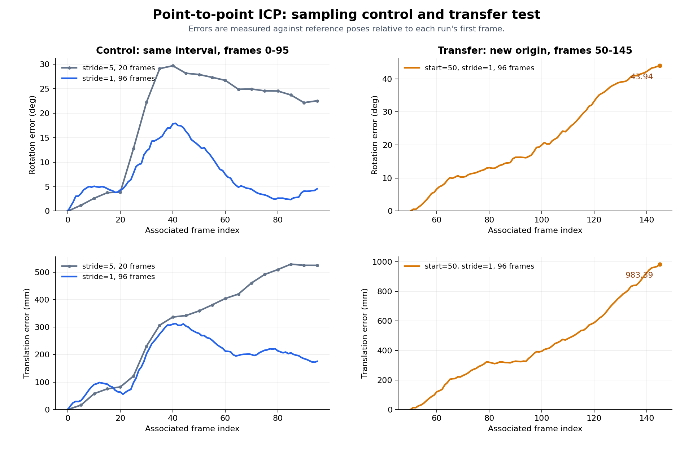

# 第二关：短序列累计与同区间采样对照

日期：2026-11-15。状态：首段短序列主流程、同区间采样对照及换起点独立迁移的实现与结果检查已完成。点到点 ICP 在新时间区间出现明显漂移，作为当前基线的失败案例保留。

## 实现与评价约定

学习者实现入口 `register_rgbd_sequence.py`。每次将当前 source 相机点云向上一帧 target 配准，使用 `T_acc = T_acc @ T_step` 累计到所选首帧坐标系。变换使用点云副本，保留原始相机坐标点云用于相邻配准；首帧加入两张地图。

参考相对变换为 `inv(T_wc_0) @ T_wc_i`，参考位姿按 RGB 时间进行平移线性插值和旋转 SLERP。参考位姿只用于参考地图与误差评价，不提供给独立 ICP 初值或对应选择。

沿用 TUM `freiburg1_desk`、默认 ROS 内参、原始深度除以 5000、有效深度 `0 < Z < 4` 米。此次规定设置为：每帧体素 0.02 米、最大对应距离 0.10 米、最多 200 轮、误差变化容差 1e-6。每对 ICP 初值为单位矩阵。

CSV 记录相对于首帧参考变换的旋转角误差与平移向量差范数。首帧的零误差来自共同坐标原点约定。这里不进行额外轨迹拟合或尺度对齐。

## 同一区间对照

两组均从关联记录 `matches[0]` 开始，在 `matches[95]` 结束，RGB 时间为 1305031453.359684 到 1305031456.527641，跨度约 3.167957 秒。

| 项目 | stride=5，20 帧 | stride=1，96 帧 |
|---|---:|---:|
| 相邻配准次数 | 19 | 95 |
| 末帧旋转误差 / ° | 22.533891 | 4.547447 |
| 末帧平移误差 / mm | 525.428858 | 175.433641 |
| 共同 20 个时刻的平均平移误差 / mm | 309.079824 | 180.424570 |
| 估计地图保存点数 | 180365 | 870998 |
| 参考地图保存点数 | 180365 | 870998 |

共同 20 个时刻指关联索引 0、5、10……95；stride=1 的均值仅取这些时刻，而非直接与全部 96 个时刻的均值混比。相同区间下，末帧旋转误差降低约 79.82%，平移误差降低约 66.61%。这些结果支持本段序列中更密集的相邻配准改善了当前基线，不能推广为所有场景都应使用相同设置。

地图是各帧下采样点云直接叠加的结果，尚未做最后一次全局体素去重。更多采样帧会自然增加保存点数，点数不作为精度指标。

## 检查证据

- 先前执行 stride=5 的 20 帧主流程，核对了 19 次相邻配准、原始点云未被变换、累计方向、首帧加入、逐帧参考误差，以及保存 PLY 与内存地图一致。
- 本次读取学习者两组输出，CSV 表头正确，分别为 20、96 条数据，帧序号完整且误差为有限数。
- 两组估计与参考 PLY 均可读取，点坐标为有限数；其点数与逐帧输入点数求和一致。
- 按当前反投影与下采样设置重建 96 帧的输入点云，核对两张参考地图在共同 20 帧对应点段的坐标完全相同，最大差为 0 米。这确认共同首帧和相同帧的参考坐标一致。
- 本次读取输出并核对输入及地图数据，没有重复执行 stride=1 的全部 ICP，也未观察 GUI 截图。

本地输出目录为 `outputs/sequence_stride5`、`outputs/sequence_stride1`，均包含 `estimated_map.ply`、`reference_map.ply`、`trajectory_errors.csv`。

## 换起点独立迁移验收

学习者新增 `--start-index`，选帧使用 `matches[args.start_index::args.stride][:args.max_frames]`。`first_record` 从所选列表取得，`T_wc_0` 随新首帧改变；累计估计仍从单位矩阵开始。

实际输出使用关联索引 50～145，共 96 帧、95 对相邻配准；RGB 时间 1305031455.027799～1305031458.191646，跨度约 3.163847 秒。两张地图各有 734097 点，误差 CSV 包含完整的 96 条数据。输出位于 `outputs/sequence_start50_stride1`。

| 所选序号 | 关联索引 | 累计旋转误差 / ° | 累计平移误差 / mm |
|---|---:|---:|---:|
| 0 | 50 | 0.000000 | 0.000000 |
| 1 | 51 | 0.566199 | 12.857809 |
| 20 | 70 | 10.284046 | 230.030783 |
| 40 | 90 | 16.286582 | 326.895734 |
| 60 | 110 | 24.743204 | 480.086241 |
| 80 | 130 | 38.998039 | 763.917531 |
| 95 | 145 | 43.941491 | 983.390379 |

本次核对不重复执行全部 ICP：重新生成关联索引 50～145 的原始点云，逐帧检查参考地图与 `inv(T_wc_50) @ T_wc_i` 一致，最大坐标差约 8.88e-16 米；确认参考坐标原点已切换到第 50 组。

估计地图保留了逐帧点段和点序，利用原始点与保存点的一一对应关系，通过已实现的刚体拟合恢复每帧累计变换。重建坐标最大残差约 7.86e-14 米；由恢复矩阵重新计算的旋转、平移误差与 CSV 一致，分别在 1e-9 度和 1e-12 米容差内。该检查用于核对坐标、保存对象和评价的数据流。

由相邻累计矩阵恢复出的单步变换，最大旋转误差约 1.632°（关联 98→97）。该区间体现连续小误差的累积漂移，而不是一次几十度的单步突变。尚未单独验证这些局部误差的具体场景或传感器成因。

换起点的实现与误差记录通过检查；当前方法在该区间的配准质量较差。迁移区间与首段区间不同，不将两段末帧误差差异当成单一参数的因果对照。

## 误差曲线



左列比较相同关联区间 0～95 的两种采样；右列单独显示关联区间 50～145 的迁移结果。所有轨迹相对各自首帧评价。首段步长 1 的误差在中途也有峰值，因此同时展示完整曲线和末帧数值。

## 较大步长下的困难帧对

独立运行既有帧对工具，使用相同的原始相机坐标点云、单位矩阵初值和 200 轮上限：

| source→target 关联索引 | 自实现旋转误差 / ° | Open3D 旋转误差 / ° | 自实现平移误差 / mm | 自实现更新数 |
|---|---:|---:|---:|---:|
| 25→20 | 10.889203 | 10.912917 | 96.169490 | 24 |
| 30→25 | 9.733021 | 9.748193 | 113.378598 | 25 |
| 35→30 | 6.904234 | 7.025371 | 65.982487 | 28 |

这三对参考旋转变化约为 10.85°、10.78°、10.13°。单步配准已经存在较大位姿误差，两种实现表现接近。这支持从相邻运动幅度和局部配准条件排查，而非仅将累计误差归因于矩阵连乘。具体错误对应或场景几何原因尚未单独验证。

## 复现命令

从项目根目录运行：

```powershell
python register_rgbd_sequence.py --sequence data/tum/rgbd_dataset_freiburg1_desk --stride 5 --max-frames 20 --voxel-size 0.02 --max-distance 0.10 --max-iterations 200 --tolerance 1e-6 --output outputs/sequence_stride5
python register_rgbd_sequence.py --sequence data/tum/rgbd_dataset_freiburg1_desk --stride 1 --max-frames 96 --voxel-size 0.02 --max-distance 0.10 --max-iterations 200 --tolerance 1e-6 --output outputs/sequence_stride1
python register_rgbd_sequence.py --sequence data/tum/rgbd_dataset_freiburg1_desk --start-index 50 --stride 1 --max-frames 96 --voxel-size 0.02 --max-distance 0.10 --max-iterations 200 --tolerance 1e-6 --output outputs/sequence_start50_stride1
```

增加 `--show` 会在保存后依次显示估计地图和参考地图。CSV 距离列单位为米，本报告表格换算为毫米。

## 交付与边界

第二关基础算法、真实帧对、短序列累计、采样对照和换起点的实现检查已完成。README、结果报告和曲线已整理；Git 提交和上传由学习者亲自执行，尚未验证第二关远端发布。

当前为局部点到点 ICP 的短序列基线：首段步长 1 仍有约 17.54 cm 的末帧平移误差，换起点区间约为 98.34 cm。验收确认实现、复现和失败分析；当前结果不足以支持高精度重建或完整 SLAM 的声明。后续实例关联先用提供位姿隔离关联模块的误差来源。

## 补充诊断：配准方法的影响

针对“是否是数据集问题”的疑问，在同一关联区间 50～145 上做库方法对照。复用学习者的图像读取与反投影函数缓存同一批 96 帧点云，逐对从单位矩阵初始化，最大对应距离 0.10 米、最多 200 轮，Open3D 两种方法均使用 `relative_fitness=1.0, relative_rmse=1e-6`。参考位姿只用于评价。

点到面方法需要法向；对输入点云以半径 0.10 米、最多 30 个邻居估计法向。点到点方法使用相同坐标但不使用法向。没有改动学习者核心脚本；诊断数据保存在 `outputs/_diagnose_icp_variants_start50/metrics.csv`。

| 方法 | 末帧旋转误差 / ° | 末帧平移误差 / mm |
|---|---:|---:|
| 学习者点到点 ICP，已有输出 | 43.941491 | 983.390379 |
| Open3D 点到点 ICP，本次复跑 | 43.942250 | 983.793431 |
| Open3D 点到面 ICP，本次复跑 | 12.391306 | 289.454214 |

自实现与库的点到点结果接近。更换为点到面及其法向约束后，同一输入下误差明显减小，说明前端配准方法与这些误差有关；这不证明剩余误差都来自某一种因素，也不构成跨序列最优性结论。

读取约定另与 [TUM 官方格式及标定说明](https://cvg.cit.tum.de/data/datasets/rgbd-dataset/file_formats) 核对：PNG 深度除以 5000，深度已预先配准到 RGB，官方提供并推荐在未额外去畸变的该类输入上采用 ROS 默认参数。当前读取方式符合该示例；此核对不消除真实传感器噪声、标定误差或残余时间不同步。

[Open3D ICP 文档](https://www.open3d.org/docs/release/tutorial/pipelines/icp_registration.html) 说明了局部初始化和点到点、点到面两类目标函数。此次诊断支持优先检查当前局部配准约束与累计漂移，不支持直接认定数据集损坏或更换数据集即可解决问题。
