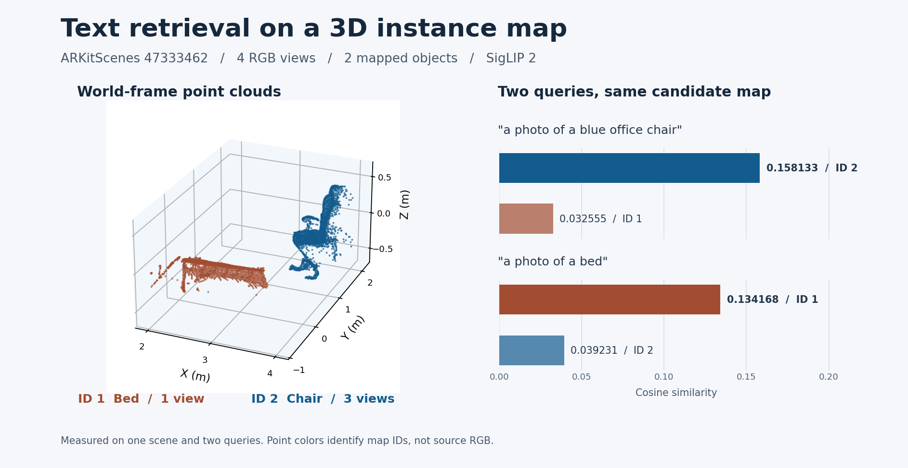

# 第四关：同场景双实例文本检索验收

## 输入与处理

使用 ARKitScenes 场景 `47333462`，以数据集提供的相机位姿构建世界坐标实例地图。检测提示分别为 `a chair.` 和 `a bed.`；检测与掩码用于产生候选，不参与文本排序。每条查询都对同一份实例库排序，不重新检测或筛选类别。

图像输入为原图的检测框裁剪（`box`），编码器为 `google/siglip2-base-patch16-256`。每张图的 768 维向量先做 L2 归一化，同一实例的视角向量求均值后再归一化。文本特征归一化后与实例向量点积，即余弦相似度。复现命令见[第四关 D](../docs/STAGE_04.md#d-用文本查找地图实例)。

## 产物核对

| 地图实例 | 来源帧时间 | 视角特征行 | 世界坐标点数 |
| --- | --- | --- | ---: |
| ID 1 · 床 | `57372.880` | `[0]` | 1658 |
| ID 2 · 椅子 | `57390.089`、`57390.889`、`57391.689` | `[1, 2, 3]` | 2621 |

核对了学习者本地落盘产物：两份输入报告的四条来源可按 `(frame_id, local_id)` 与检测记录对应，四张裁剪都能按索引定位，地图点数与实际读取的 PLY 一致。视角特征 `(4, 768)`，实例特征 `(2, 768)`，均为有限的 `float32`，各行 L2 范数约为 1。按 `view_feature_indices` 重新计算聚合向量，与保存值一致。

## 查询结果

| 文本查询 | Top-1（余弦相似度） | Top-2（余弦相似度） | 第一与第二分差 |
| --- | --- | --- | ---: |
| `a photo of a blue office chair` | ID 2 · 椅子（0.158133） | ID 1 · 床（0.032555） | 0.125578 |
| `a photo of a bed` | ID 1 · 床（0.134168） | ID 2 · 椅子（0.039231） | 0.094937 |

图中左侧是实际保存的两份 PLY 的投影，颜色标识 `map_id`，不是原图颜色；右侧为终端实测分数。数据出处：[ARKitScenes 论文](https://openreview.net/forum?id=tjZjv_qh_CE) · [数据许可](https://github.com/apple-aiml-research/ARKitScenes/blob/main/LICENSE)。

## 结论与边界

两条查询都将对应的真实实例排到第一，且返回的视角能够追溯到裁剪图和原始帧，完成本关的双实例独立验收。椅子只有一个候选实例，所以不能据此判断 `blue` 是否提供了有效的颜色区分。床的掩码没有覆盖整个物体，点云仅表示该帧观测到的部分。本次未比较单视角与多视角检索、未包含无目标查询、未使用估计位姿，也没有测量留出场景准确率。
