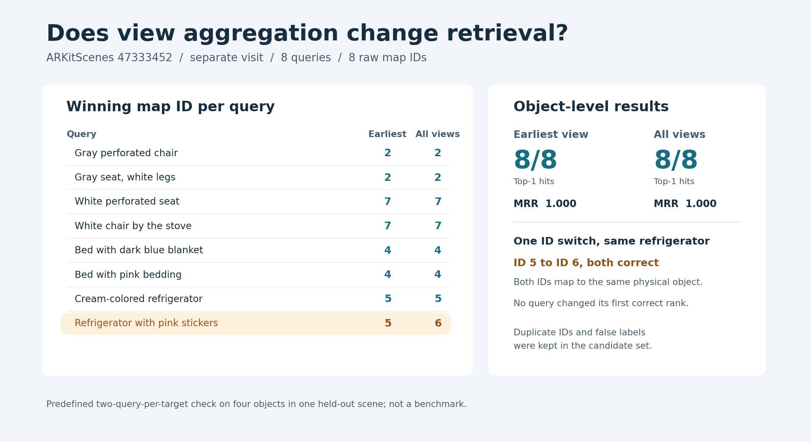

# 第五关：首视角与多视角检索对照

## 协议

开发场景为 ARKitScenes `47333462`，留出场景为不同访次的 Validation 序列 `47333452`。两组评估在各自场景内共享地图候选、SigLIP 2 编码器、检测框裁剪和查询标签；只改变每个地图 ID 的表示：使用时间最早的有效视角，或平均所有可用视角并做 L2 归一化。建图使用数据集提供的位姿，不使用独立估计的轨迹。[执行步骤](../docs/STAGE_05.md) · [官方数据划分](https://github.com/apple-aiml-research/ARKitScenes/blob/main/raw/raw_train_val_splits.csv)

留出场景从 516 个已关联帧中预先固定 8 帧。17 条二维检测中有 2 条因同一帧置信度图全零无法生成有效点云；保留 15 条观测及其图像裁剪，映射到 8 个原始地图 ID。两库的实例向量均为 `(8, 768)`；按 `map_id` 核对，首视角每个 ID 使用一帧，全视角组的视角数依次为 `[1, 2, 2, 2, 2, 2, 3, 1]`。未根据结果删候选或重选视角。

8 条留出查询对应 4 个真实对象，每个对象两种描述。若同一对象有多个地图 ID，任一事先核对的正例都算命中。Top-1 检查第一名是否在正例集合内，MRR 取每条查询的第一个正例名次的倒数，再做平均。乱序三候选与多答案的独立测试验证了索引查找、旧单答案兼容和非首位命中。

## 实测

| 场景 | 查询 / 地图候选 | 首视角 Top-1 / MRR | 多视角 Top-1 / MRR |
| --- | --- | --- | --- |
| 开发 `47333462` | 6 / 2 | 6/6 / 1.0 | 6/6 / 1.0 |
| 留出 `47333452` | 8 / 8 | 8/8 / 1.0 | 8/8 / 1.0 |

留出场景两份落盘报告按 `query_id` 对齐并重新核算。下表相似度是**各自第一名**与文本的余弦，不是置信度，也不是第一名与第二名的差值。

| 查询 ID | 正确地图 ID | 首视角第一名 / 余弦 | 多视角第一名 / 余弦 |
| --- | --- | --- | --- |
| `gray_chair_01` | 2 | 2 / 0.171592 | 2 / 0.168254 |
| `gray_chair_02` | 2 | 2 / 0.159102 | 2 / 0.160435 |
| `white_chair_01` | 7 | 7 / 0.184016 | 7 / 0.191804 |
| `white_chair_02` | 7 | 7 / 0.146675 | 7 / 0.137585 |
| `bed_01` | 4、8 | 4 / 0.140987 | 4 / 0.138987 |
| `bed_02` | 4、8 | 4 / 0.127928 | 4 / 0.124551 |
| `fridge_01` | 5、6 | 5 / 0.131198 | 5 / 0.130810 |
| `fridge_02` | 5、6 | 5 / 0.125202 | 6 / 0.138901 |

在对照的查询中，首个正确目标的名次都未变化。仅 `fridge_02`（带粉色贴纸的冰箱）的第一名地图 ID 从 5 变为 6，两者是同一台冰箱。这个切换没有改善或降低物体级排名。

## 建图错误与证据边界

- 抽屉柜被误标为床及复合标签，形成 ID 1 和 3；作为原始干扰项保留。
- 同一张床形成 ID 4 和 8，ID 8 仅对应床边；冰箱形成 ID 5 和 6，首个共同出现的帧已有两条重叠检测。
- 两把不同位置、颜色不同的椅子保持为 ID 2 和 7。这里不是同一类别所有椅子都能稳定分离的结论。

两套方法都能命中本次固定闭集中的正确对象，没有观察到多视角的排名收益。8 条查询不是 8 个独立真实目标，且多答案评价不惩罚同一对象的重复 ID。实验不测未检出物体、无答案查询、定位或地图准确率；不据此声称跨场景普遍泛化，也未达到原计划的 3–5 个场景覆盖。
